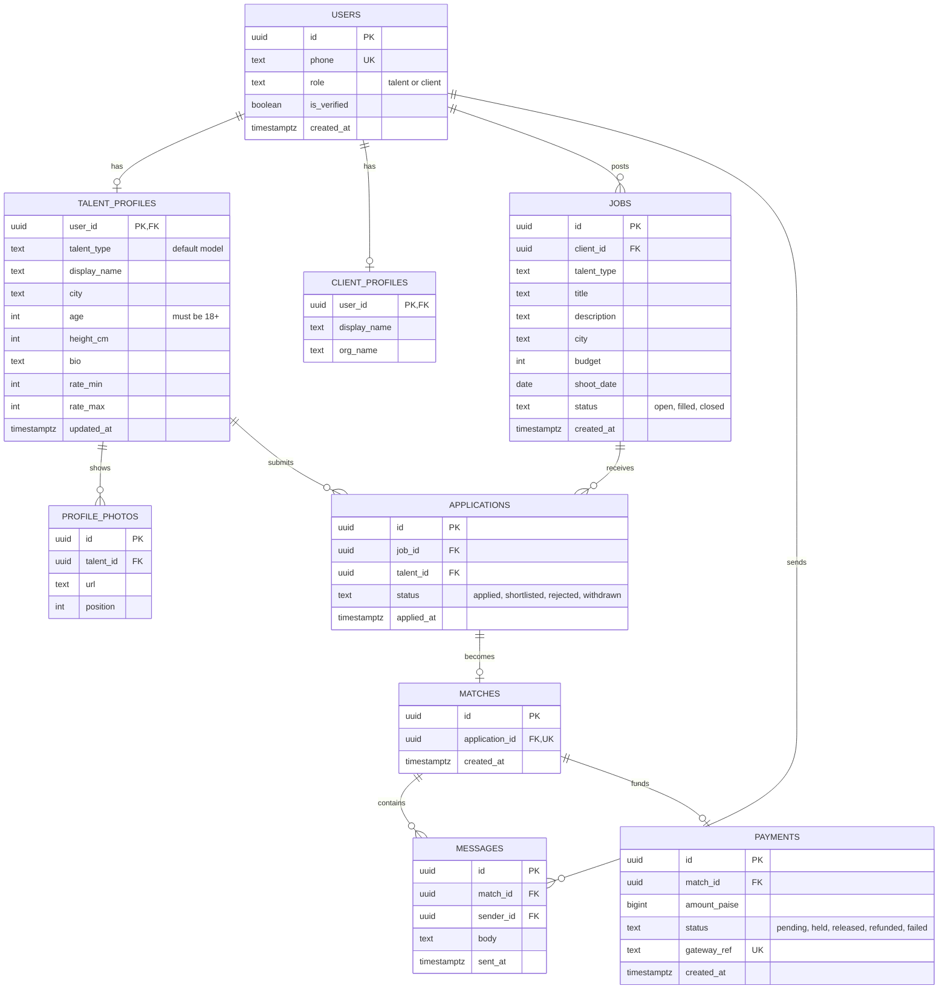
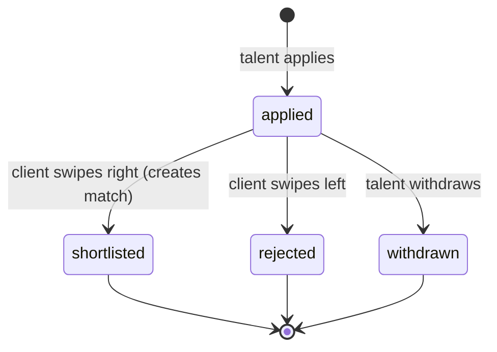
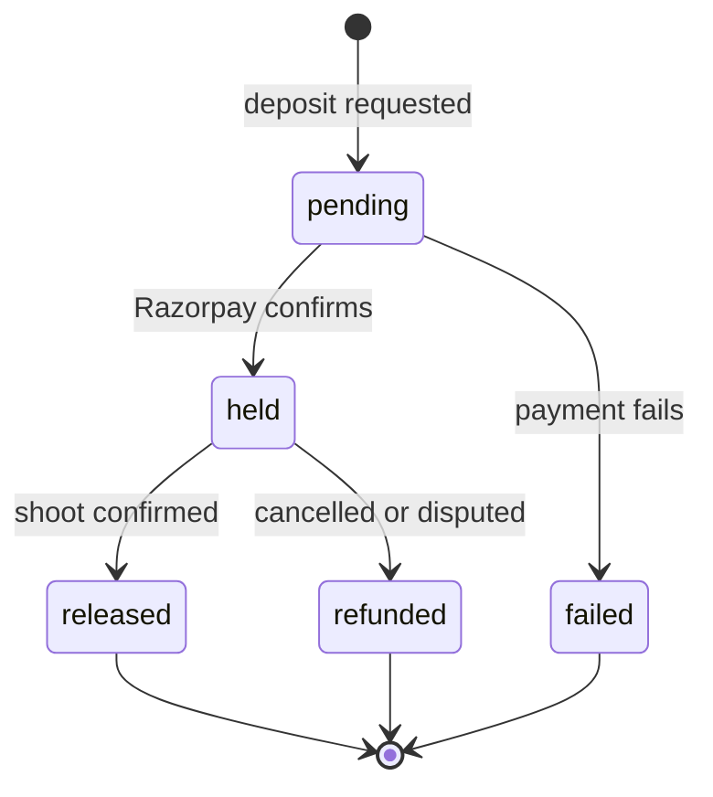

# Crewly: Data Diagram

Database: PostgreSQL 16. Migration source of truth: `backend/migrations/0001_init.sql`.
Money is stored in **paise** (`BIGINT`). All IDs are UUIDs. All timestamps are `TIMESTAMPTZ`.

## ER diagram



## Tables at a glance

| Table | Purpose | Key constraints |
|---|---|---|
| `users` | One row per person, identified by phone | `phone` unique, `role` in (`talent`, `client`) |
| `talent_profiles` | Public talent details and the swipe-card data | `age >= 18`, indexed on (`city`, `talent_type`) |
| `client_profiles` | Light client identity (clients can be anyone) | one per user |
| `profile_photos` | Ordered photos per talent | indexed on (`talent_id`, `position`) |
| `jobs` | A client's request | `status` in (`open`, `filled`, `closed`), feed index on (`city`, `talent_type`, `status`, `shoot_date`) |
| `applications` | Talent applying to a job, also holds the swipe decision | `UNIQUE (job_id, talent_id)` |
| `matches` | Created when a client shortlists an applicant | `UNIQUE (application_id)` means max 1 match per application |
| `messages` | Chat history for a match | indexed on (`match_id`, `sent_at`) |
| `payments` | Deposit and balance tracking (used from Phase 2) | `gateway_ref` unique, `amount_paise > 0` |

## Application status lifecycle



## Payment status lifecycle (Phase 2)



## Swipe query notes

**Deck for a job** (only undecided applicants, owner-only access checked in the service):

```sql
SELECT a.id, t.display_name, t.city, t.bio, t.rate_min, t.rate_max, u.is_verified,
       (SELECT url FROM profile_photos p WHERE p.talent_id = t.user_id ORDER BY position LIMIT 1) AS photo
FROM applications a
JOIN talent_profiles t ON t.user_id = a.talent_id
JOIN users u ON u.id = t.user_id
WHERE a.job_id = $1 AND a.status = 'applied'
ORDER BY a.applied_at
LIMIT $2;
```

**Decision** (single transaction; create the match only if the update affected a row):

```sql
UPDATE applications SET status = 'shortlisted'
WHERE id = $1 AND status = 'applied';

INSERT INTO matches (application_id) VALUES ($1);
```

## Planned additions (not in 0001)

- `reviews` (Phase 2): rating and text, allowed only for in-platform bookings
- `strikes` (Phase 2): no-show tracking, **3 strikes** means removal
- `disputes` (Phase 2): evidence links and review status
- `invites` (Phase 4): client-initiated invites for invite mode
