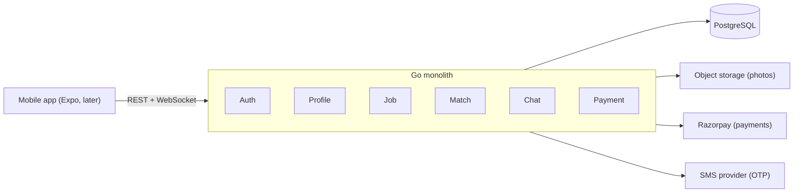

# Crewly: Design

## 1. Product in one paragraph

Crewly is a direct hiring marketplace for India's creative workforce. A client (anyone with a job) posts a request. Talent applies. The client shortlists applicants through a swipe-style deck, and a match unlocks chat, contracts and protected payments. **We replace the manager's commission, not the manager's trust.**

- **Launch:** models, India only, ages 18+
- **Scale later:** photographers, videographers, makeup artists, crew
- **Business model:** free for talent, about **5%** service fee paid by the client

## 2. Scope of the MVP

**In scope (Phase 1):** auth, profiles, job posts, apply, swipe deck, match, chat.
**Out of scope until Phase 2:** payments, verification beyond OTP, reviews, disputes.
**Out of scope until Phase 4:** invite mode, mobile app polish, other talent types.

The frontend is built later. The backend is developed and tested through the API contract in `api/openapi.yaml`.

## 3. Architecture

A single Go monolith with clear internal modules. Do not split into microservices.



## 4. Stack

| Concern | Choice | Reason |
|---|---|---|
| Language | Go | Simple concurrency for chat, strong fit for matching and payment logic |
| Router | chi | Small, idiomatic, standard `net/http` |
| DB driver | pgx | Fast, native PostgreSQL features |
| Queries | sqlc | Typed Go generated from plain SQL, no ORM magic |
| Migrations | goose | Simple SQL files, up and down |
| Database | PostgreSQL 16 | Transactions are central to the swipe and payment flows |
| Auth | Phone OTP + JWT | No passwords to store; phone is the identity |
| Realtime | WebSocket (gorilla or nhooyr) | Chat |
| Local dev | Docker Compose | Postgres plus API |

## 5. Folder structure

```
crewly/
├── README.md
├── checklist.md
├── design.md
├── data-diagram.md
├── docker-compose.yml
├── Makefile
├── backend/
│   ├── cmd/api/main.go          # wiring only, no business logic
│   ├── internal/
│   │   ├── config/              # env loading
│   │   ├── platform/            # db, logger, httpx, storage, sms, razorpay clients
│   │   ├── auth/                # handler.go, service.go, repo.go, model.go
│   │   ├── profile/
│   │   ├── job/
│   │   ├── match/
│   │   ├── chat/
│   │   └── payment/
│   ├── migrations/              # 0001_init.sql, 0002_...
│   ├── queries/                 # sqlc input
│   └── api/openapi.yaml         # contract the mobile app builds against
└── mobile/                      # Expo app, added later
```

## 6. Coding rules

1. **handler → service → repo.** Handlers parse HTTP and return responses. Services hold business rules. Repos hold SQL. Never skip a layer.
2. **Modules talk through interfaces.** For example, `match` calls `job.Service`, never `job`'s repo or tables directly.
3. **`cmd/api/main.go` only wires dependencies.** No logic there.
4. **All money is stored in paise** as `BIGINT`. Never floats.
5. **Every state change that touches more than one table runs in a single transaction.**
6. **Errors:** return typed domain errors from services; handlers map them to HTTP status codes in one place.
7. **Contract first:** update `openapi.yaml` before adding or changing an endpoint.
8. **Tests:** services get unit tests, flows (signup to match to chat) get integration tests against a real Postgres.
9. **Config via env vars only.** No secrets in the repo.

## 7. Core flows

### 7.1 Auth
1. `POST /auth/otp` with a phone number. Generate a code, store it hashed with an expiry, send via the SMS interface (dev stub logs it).
2. `POST /auth/verify` with phone and code. Create the user if new, return a JWT containing `user_id` and `role`.

### 7.2 Post a job and apply
1. A client creates a job (`status = 'open'`).
2. Talent browses `GET /jobs` with filters (city, budget, date, talent type).
3. Talent applies. `UNIQUE (job_id, talent_id)` blocks duplicates. Applying means the talent is willing to work.

### 7.3 Swipe and match (the core mechanic)
1. The job owner calls `GET /jobs/{id}/applicants` and gets a deck of applications with status `applied`.
2. **Card shows:** 1 photo, 1-line bio, city, rate range, verified badge. Full portfolio unlocks after the match.
3. Right swipe calls `POST /applications/{id}/decision` with `shortlist`. In **one transaction**:
   ```sql
   UPDATE applications SET status = 'shortlisted'
   WHERE id = $1 AND status = 'applied';
   -- only if a row was updated:
   INSERT INTO matches (application_id) VALUES ($1);
   ```
4. Left swipe sets status to `rejected`.
5. The `WHERE status = 'applied'` guard plus `UNIQUE (application_id)` on `matches` makes repeat taps and concurrent requests safe.

### 7.4 Chat
1. After a match, both participants can open `WS /ws` (JWT checked on connect).
2. Every message is persisted to `messages` before it is broadcast.
3. Only the two match participants can read or send. Phone numbers are never included in chat payloads.

### 7.5 Payments (Phase 2)
1. At match time the client pays a **20-30% deposit** into the platform via Razorpay.
2. Payment states: `pending`, `held`, `released`, `refunded`, `failed`.
3. The balance is released after the shoot is confirmed.
4. Phone numbers are shared only after the deposit. This is how the platform stays worth using without blocking off-platform contact.

## 8. API surface (MVP)

| Area | Endpoints |
|---|---|
| Auth | `POST /auth/otp`, `POST /auth/verify` |
| Profile | `GET /me/profile`, `PUT /me/profile`, `POST /me/photos` |
| Jobs | `POST /jobs`, `GET /jobs`, `GET /jobs/{id}` |
| Apply | `POST /jobs/{id}/apply` |
| Swipe | `GET /jobs/{id}/applicants`, `POST /applications/{id}/decision` |
| Matches | `GET /matches` |
| Chat | `GET /matches/{id}/messages`, `WS /ws` |
| Ops | `GET /health` |

All list endpoints use **cursor pagination**.

## 9. Trust and safety (shapes the design even before Phase 2)

- Talent verification: phone OTP, selfie match against portfolio, linked Instagram
- Client verification too: fake casting calls are a known risk for models
- 18+ only, enforced in the database (`CHECK (age >= 18)`)
- No-show: deposit forfeited plus a strike; **3 strikes** means removal
- Disputes: 48-hour window, evidence uploaded in-app, manual review at launch

## 10. Non-goals

- No microservices
- No ORM
- No custom payment handling beyond Razorpay
- No swipe on talent who have not applied (invite mode) in the MVP
